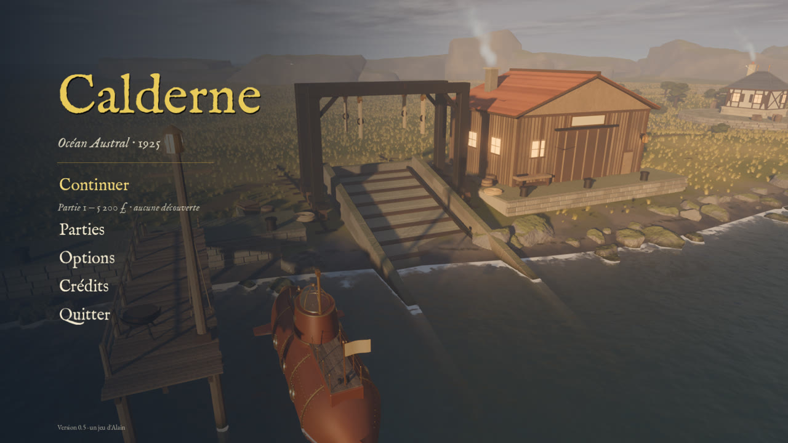
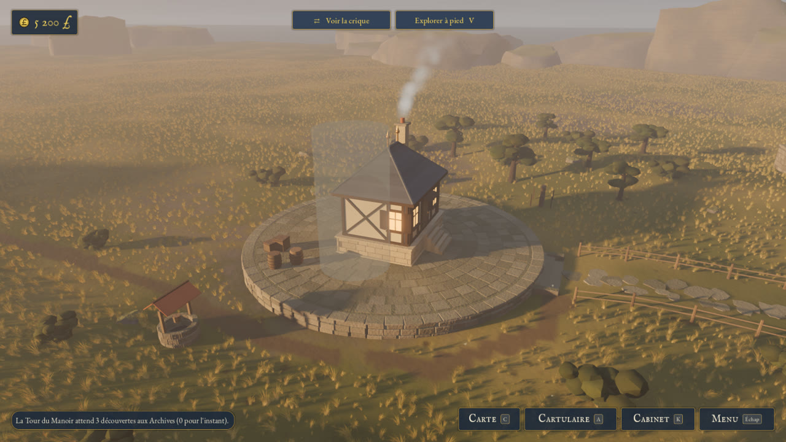
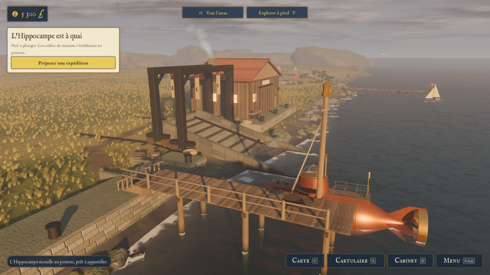
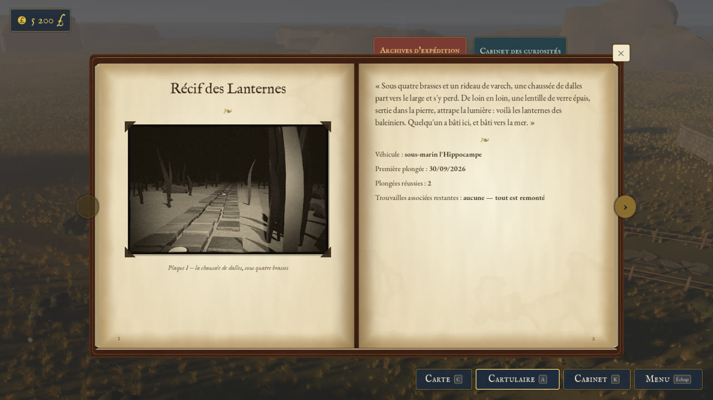
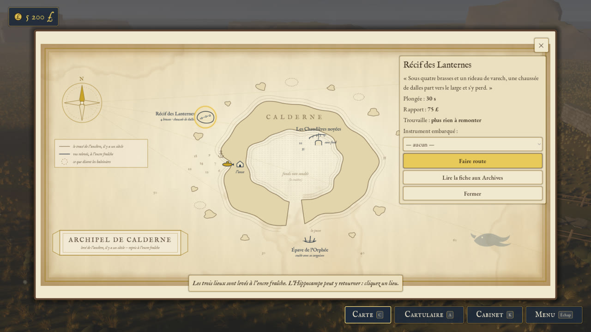
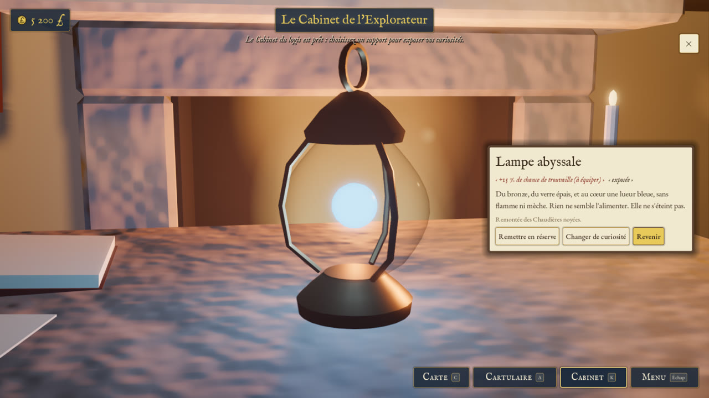

# Calderne

*Une île de l'océan Austral, en 1925. Un antiquaire y revient sur la terre qui porte son nom,
et fouille les ruines d'une civilisation éteinte depuis neuf mille ans.*

Un jeu d'exploration et de découverte pour Windows, conçu par Alain.

## Télécharger et jouer

Le jeu est dans les [**Releases**](../../releases/latest) : télécharger le zip
(`Calderne-0.8.0-alpha.zip`, 74 Mo). Il n'y a rien à installer.
Ce qui change d'une version à l'autre est écrit avec chaque version, dans les Releases.

1. Extraire le dossier `Calderne` du zip, où l'on veut (le Bureau, par exemple).
2. Ouvrir le dossier et lancer **`Calderne.exe`**. Son voisin, `Calderne.pck`, contient le jeu
   lui-même : les deux fichiers doivent rester ensemble.

**Il faut** Windows 10 ou 11 (64 bits), et une carte graphique qui gère Vulkan (la plupart
des cartes de moins de dix ans).

**Au premier lancement**

- Windows peut afficher « Windows a protégé votre ordinateur » : le jeu n'est pas signé par un
  certificat payant. Cliquer sur « Informations complémentaires », puis sur « Exécuter quand
  même ».
- Certains antivirus l'examinent quelques secondes avant de le laisser partir.

Les parties s'enregistrent d'elles-mêmes, dans `%APPDATA%\Calderne` (trois emplacements). Les
commandes sont dans les options du jeu, onglet « Les commandes ».

## Le jeu

Quelque part entre la Nouvelle-Zélande et la pointe de l'Amérique du Sud, Calderne est une île
froide, venteuse et brumeuse, que personne n'habite. Un comptoir baleinier en a rapporté un
éclat de pierre traversé d'une veine bleue qui ne refroidit jamais. Le dernier des Calderne,
antiquaire, s'installe dans une anse avec une tente et quelques caisses.

- **Bâtir** son domaine : les fondations, la façade, la toiture, puis la Tour du manoir.
- **Rebâtir l'Hippocampe**, une épave de sous-marin renflouée, et le lancer à la mer.
- **Plonger** vers trois lieux engloutis, et en rapporter des photographies sur plaque et des
  curiosités.
- **Commercer avec le comptoir**, qui grandit avec vos découvertes — jusqu'à ce que la Couronne
  vous écrive.
- **Tenir ses registres** : la Carte de l'ancêtre ; le Cartulaire, un registre à rubans — les
  archives, les curiosités, le journal de bord, les comptes et la correspondance ; le Cabinet, où
  l'on expose ses trouvailles.
- **Marcher** dans l'anse et la crique, à hauteur d'homme.

| | |
|:-:|:-:|
|  |  |
| *L'anse et le logis* | *La crique, le ponton et l'Hippocampe* |
|  |  |
| *Le Cartulaire : le journal de bord de l'explorateur* | *La Carte de l'ancêtre* |
|  | |
| *Le Cabinet de l'explorateur* | |

La musique, « Calderne », chante le nom de l'île : à la manière de l'hommage de Ravel et de
Debussy au nom de Haydn (1909), ses lettres deviennent **do – la – mi – ré – mi – ré – sol – mi**.

## Crédits

- **Le jeu** : l'île, son histoire et ses mystères, Alain. Le code, les modèles 3D, l'interface
  et la musique ont été réalisés avec Claude Code (Anthropic), sous sa direction.
- **Le moteur** : [Godot Engine](https://godotengine.org), licence MIT.
- **Les polices** : IM Fell English et EB Garamond, licence SIL Open Font License 1.1 ;
  Special Elite, licence Apache 2.0.
- **Les sons et les instruments de la musique** : des enregistrements versés au domaine public
  (CC0) par Kenney, BigSoundBank, des auteurs d'OpenGameArt et Versilian Studios.

Le détail, avec le texte des licences, est dans l'écran « Crédits » du jeu.

---

Ce dépôt ne contient que le jeu à télécharger et ces images ; son code source n'est pas
public. Tous droits réservés.
